<a href="https://aneeshmelkot.com">
  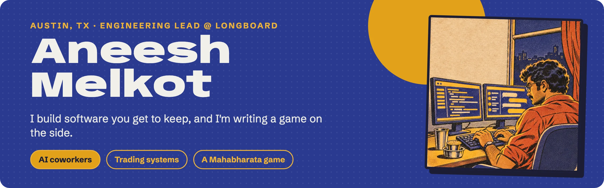
</a>

  
  
  
  
  

I build AI coworkers and the systems that run a trading desk. Most of what I make in my own time is **open source, self-hosted, and yours to run**: your machine, your keys, your data. By day I'm the one-person engineering team behind **[Longboard Asset Management](https://longboardfunds.com/)**'s trading systems. After hours I'm writing a game about Bhima the cook. Independent work ships under **[Matangi Labs](https://www.matangilabs.com/)**.

## 🛠️ What I'm building

  <a href="https://github.com/matangilabs/kortny">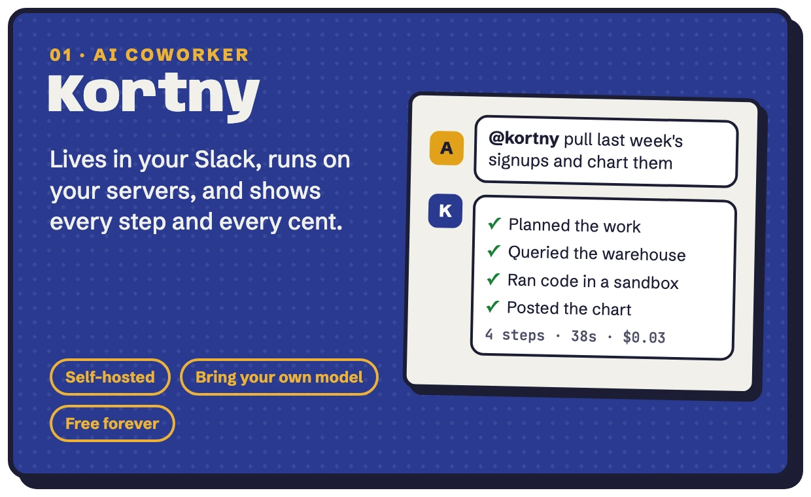</a>
  <a href="https://github.com/boffti/starwire">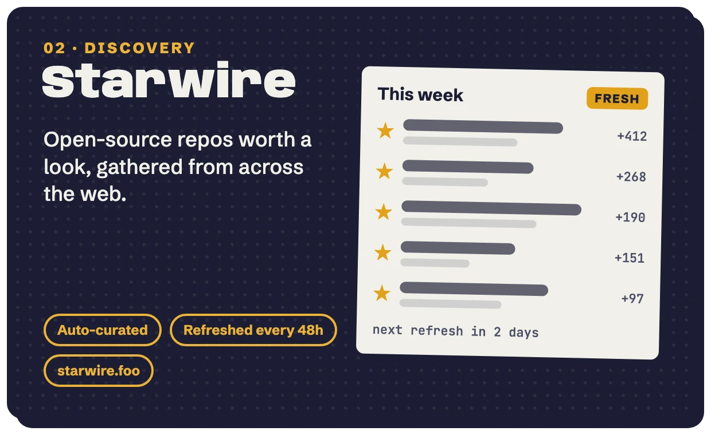</a>

  <a href="https://github.com/boffti/stardash">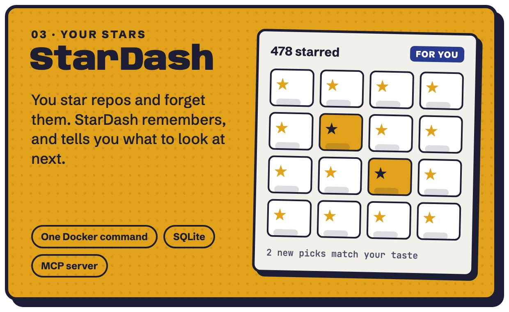</a>
  <a href="https://github.com/boffti/whetstone">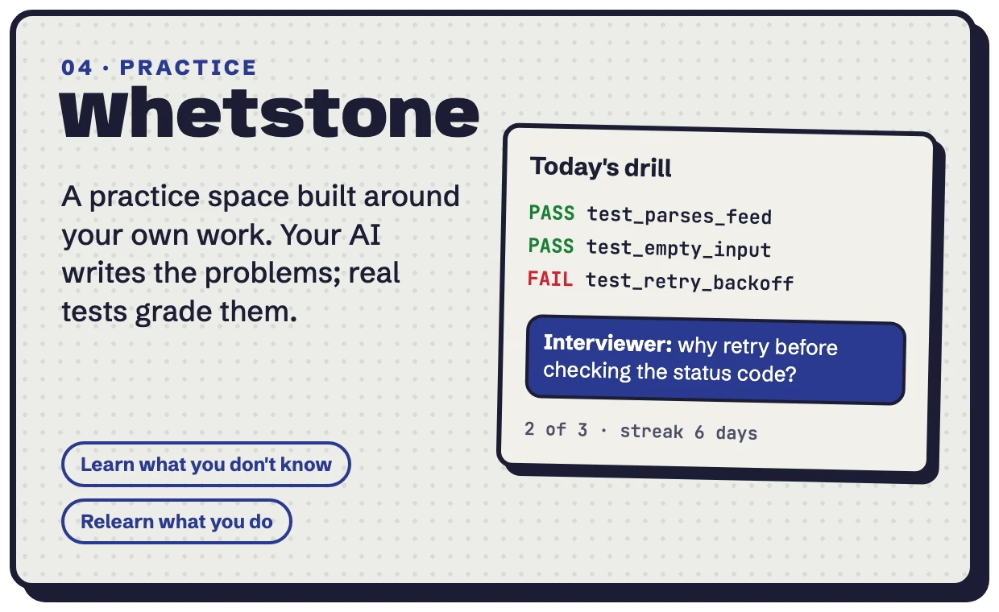</a>

Try them: <a href="https://kortny.dev">kortny.dev</a> · <a href="https://starwire.foo">starwire.foo</a> · <a href="https://stardash.dev">stardash.dev</a> · <a href="https://github.com/boffti/whetstone">whetstone</a> · live stars in the pins below

## 📈 By day: I am Longboard's engineering department

[Longboard Asset Management](https://longboardfunds.com/) runs a systematic, trend-following mutual fund, and I'm its entire technology team: architect, engineer, DevOps, data and on-call, effectively the firm's CTO. Every trade the fund places is generated by a system I run, on infrastructure I built, and nobody else gets paged.

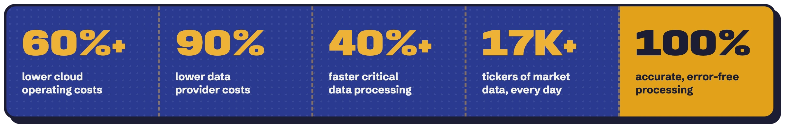

> [!IMPORTANT]
> **What's at stake.** This isn't a dashboard going red. If the overnight run is late, the fund doesn't trade. If a position or a cost basis is wrong, it's investors' money and a regulated record that's wrong. The job is to be right, on time, every trading day.

**What I built and run**

<table>
  <tr>
    <td width="33%" valign="top"><b>⚙️ Trading engine</b> Turns market data into each day's trades, trade files and position reports.</td>
    <td width="33%" valign="top"><b>🔬 Analytics and research engine</b> Tools for studying how the strategy behaves over the long run.</td>
    <td width="33%" valign="top"><b>🚰 Data pipelines</b> Market and custodian data, ingested, adjusted and reconciled every day.</td>
  </tr>
  <tr>
    <td width="33%" valign="top"><b>🤖 Automation</b> Celery and n8n workflows that replaced manual work across operations.</td>
    <td width="33%" valign="top"><b>🧠 AI research and reporting</b> Pipelines that draft research and reports with frontier models, custom MCPs and connectors, for people to review.</td>
    <td width="33%" valign="top"><b>☁️ Cloud and monitoring</b> Infrastructure as code, with logging and alerts across the whole operation.</td>
  </tr>
</table>

I also build the firm's compliance tooling: checkers that review public copy against SEC and FINRA advertising rules before it reaches a human reviewer. On the research side, I'm studying how a rules-based trend follower should get back in after a crash, a question the published research has mostly left open.

## 🍲 After hours: a game about Bhima the cook

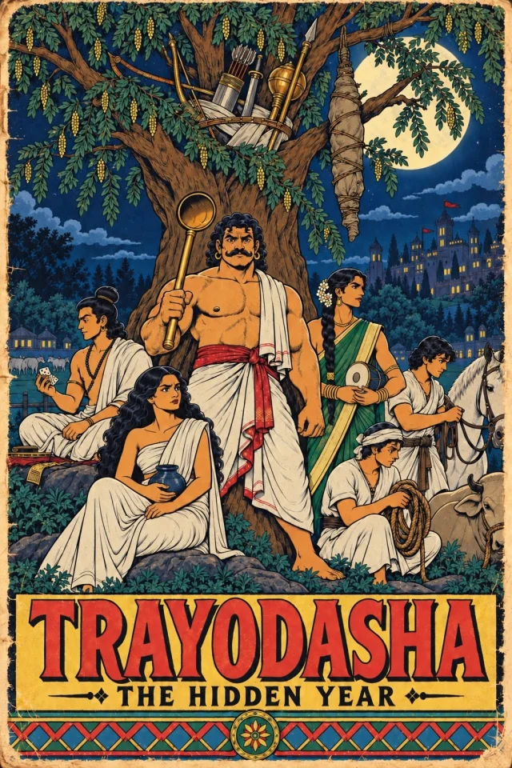

It's the last year of the Pandavas' exile, the [hidden year of the Virata Parva](https://en.wikipedia.org/wiki/Virata_Parva): if anyone recognises them, they go back to the forest for another twelve. So Bhima, the strongest man alive, hides in plain sight as **Ballava, the palace cook** of King Virata.

Lay low and do your job. **By morning** you cook for the court from a pantry deck, and a good meal keeps eyes off you. **By afternoon** you wrestle in the king's arena, winning without ever showing what you really are. **By night** you go into the dreams and fight demons with everything you held back all day.

It's a roguelite deckbuilder with three decks woven into one year, and a story that runs through all of it. It's drawn like the 1970s Indian mythological comics many of us grew up reading, and it will be **completely free to play**.

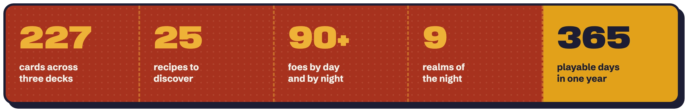

<table>
  <tr>
    <td width="33%"></td>
    <td width="33%">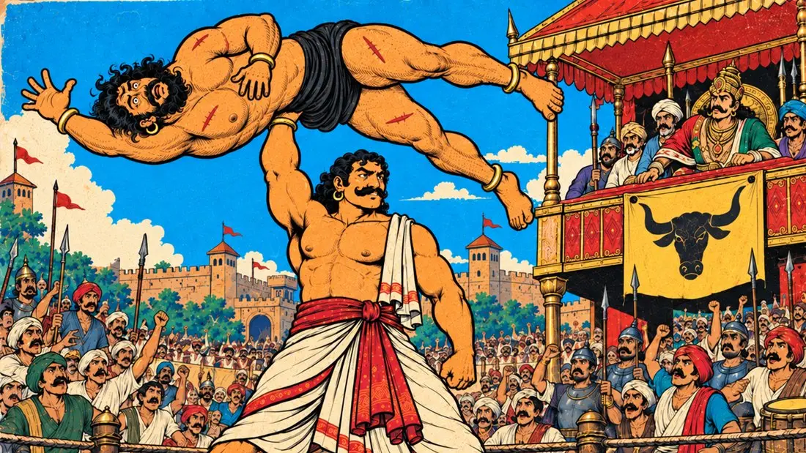</td>
    <td width="33%">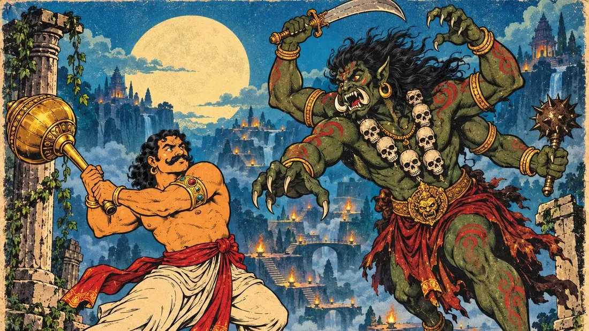</td>
  </tr>
  <tr>
    <td align="center"><b>Morning:</b> the kitchen</td>
    <td align="center"><b>Afternoon:</b> the arena</td>
    <td align="center"><b>Night:</b> the dreams</td>
  </tr>
</table>

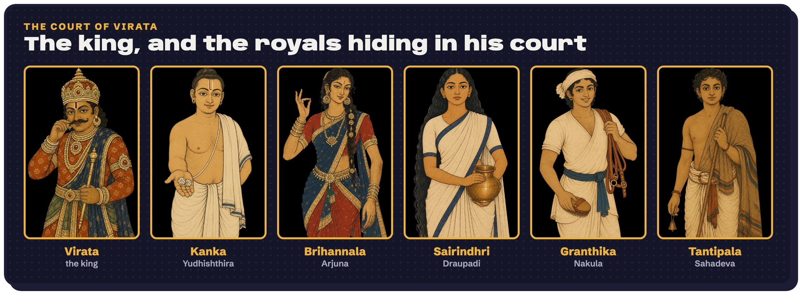

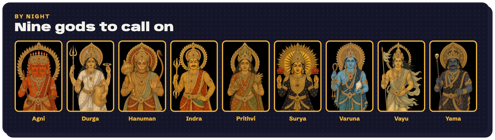

## 🧰 Stack

  

Plus Celery, MCP, Google ADK, LiteLLM, Slack Bolt, n8n and Typst.

  
<b>How I like to work</b>

   

- **The smallest change that works.** Fewer files, fewer dependencies, a shorter diff. Simple code reads as intent.
- **Verify, then claim.** Nothing ships until someone has watched it work. In AI systems, checking the answer beats fetching more context.
- **If it needs a lesson, it's a defect.** Legibility beats elegance, in a game mechanic or an admin page.
- **Evals, not vibes.** A prompt that is patched every week needs a test suite, not another patch.
- **Own the stack.** Self-hosted, bring your own model, and no company that can take it away from you.
- **Plain words on buttons.** Systems can have beautiful names. The button still says what it does.

  
<b>I also write about psychology, seen by an engineer</b>

   

- [Aggression and operant conditioning in video games](https://psyc6300.blogspot.com/2022/06/aggression-and-operant-conditioning-in.html)
- [Internet addiction and ethics](https://psyc6300.blogspot.com/2022/07/internet-addiction-and-ethics-from-lens.html)
- [Cognitive biases in e-commerce](https://psyc6300.blogspot.com/2022/07/cognitive-biases-in-e-commerce-from.html)
- [Personas: psychology in UI design](https://psyc6300.blogspot.com/2022/06/correlation-of-psychology-with-software.html)
- [Social engineering: hacking humans](https://psyc6300.blogspot.com/2022/06/social-engineering-in-psychology.html)

---

<b>Building something with agents, markets, or myths?</b> <a href="mailto:boffti@gmail.com">Write to me.</a>

